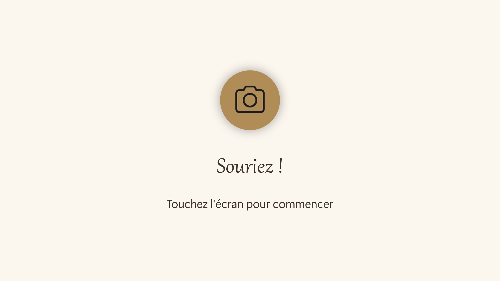
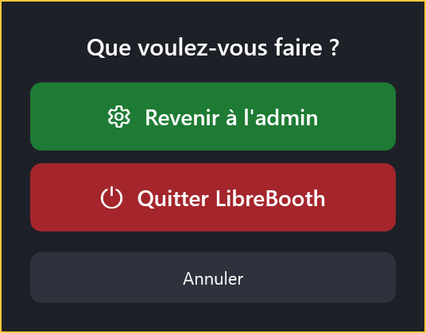

<p align="center"></p>

# LibreBooth

Logiciel de photobooth **gratuit et libre** pour Windows, conçu et réalisé par **Loïs Gonçalves**.

LibreBooth pilote un appareil photo **Canon EOS** et imprime sur une imprimante photo **DNP**, avec un écran tactile
(ou une souris). Il est fait pour les mariages, anniversaires et soirées d'entreprise : chaque événement a ses
propres impressions, ses propres écrans et son propre dossier de photos.

<p align="center">
  
  
</p>

## Ce que fait LibreBooth

- **Accueil plein écran** : « Touchez l'écran pour commencer », ou un bouton d'arcade USB qui imite une touche.
- **Choix du format** : **10x15 une photo** ou **marque-page 3 photos** (imprimé deux fois sur un 10x15 que la DNP
  coupe en deux).
- **Live view** du Canon en plein écran, en miroir, avec un **compte à rebours** et un flash blanc.
- **Montage automatique** habillé pour l'événement : six thèmes (mariage, anniversaire, entreprise), textes, polices,
  couleurs, décor, ou vos **propres images** (fonds faits dans Canva ou Photoshop, logo).
- **Écrans aux couleurs de l'événement**, avec une image d'accueil propre à chaque événement.
- **Impression** sur la DNP : l'invité choisit ses exemplaires (jusqu'au maximum fixé pour l'événement).
- **Recommencer** : l'invité refait sa série tant qu'il n'a rien imprimé ; la série refusée est gardée à part.
- **Admin d'abord** : au lancement, le code PIN puis l'administration dans une fenêtre normale ; le photobooth plein
  écran démarre avec « Démarrer le photobooth ». Un bouton rond sur l'accueil permet, avec le code PIN, de revenir
  à l'admin ou de quitter.
- **Vérification de l'installation** : dossiers, fichiers, pilotes, imprimante et appareil photo, avec ce qu'il faut
  faire en cas de problème.
- **Envoi par e-mail** (désactivé par défaut) : file d'attente qui part dès que le réseau revient.
- **Fiabilité** : chaque photo est écrite sur le disque dès son arrivée, l'appareil se reconnecte tout seul, une
  erreur affiche un message clair puis le photobooth repart, la mise en veille de Windows est bloquée.

<p align="center">
  
  
</p>

## Matériel

| | Conseillé | Testé |
|---|---|---|
| PC | Windows 10 ou 11, **64 bits** | Windows 11 |
| Appareil photo | Canon EOS reconnu par le SDK Canon EDSDK 13, en USB | Canon EOS 1300D |
| Imprimante | Imprimante photo DNP (sublimation thermique) | DNP DS620, rouleau 15x20 (deux 10x15 par feuille), pilote Windows 11 v2.0.1.2 |
| Écran | Tactile de préférence (la souris marche aussi) | |

## Installation

1. **Téléchargez** la dernière version dans la page [Releases](../../releases) :
   `LibreBooth-x.y.z-Installation.exe` (ou le zip, à décompresser où vous voulez). Le fichier
   `LibreBooth-x.y.z-SHA256.txt` donne leurs empreintes, pour vérifier le téléchargement.
2. **Installez** : double-cliquez sur le programme d'installation. Il n'est pas signé par un éditeur : si Windows
   affiche « Windows a protégé votre ordinateur », cliquez **Informations complémentaires**, puis **Exécuter quand
   même**. LibreBooth s'installe dans `C:\Program Files (x86)\LibreBooth`, avec ses raccourcis.
3. **Ajoutez les pilotes des fabricants** : ils ne sont pas fournis, car ils appartiennent à Canon et à DNP.
   - **Appareil Canon (obligatoire)** : inscrivez-vous (gratuitement) au
     [programme développeurs de Canon](https://www.canon-europe.com/business/imaging-solutions/sdk/) et téléchargez
     le SDK **EDSDK**. Copiez `EDSDK.dll` et `EdsImage.dll` de sa version **32 bits** (dossier `EDSDK\Dll`) dans
     `C:\Users\<nom>\LibreBooth\Pilotes` (dossier créé au premier lancement de LibreBooth), puis relancez LibreBooth.
   - **Imprimante DNP** : installez son pilote Windows depuis la
     [page Téléchargements de DNP](https://dnpphoto.eu/downloads/), puis branchez l'imprimante en USB.
   - **Facultatif** : `cspstat.dll` (API d'état des imprimantes DNP), à copier aussi dans le dossier `Pilotes`. Elle
     permet de lire le compteur de tirages et les erreurs (papier, ruban, capot). Sans elle, LibreBooth compte
     lui-même ses tirages.
4. **Vérifiez** : à la fin de l'installation, laissez cochée **« Vérifier que tout fonctionne »**, ou plus tard :
   menu Démarrer › LibreBooth › « Vérifier l'installation de LibreBooth ». Chaque point manquant est expliqué.

Vos photos, événements et réglages sont dans `C:\Users\<nom>\LibreBooth`. Ils ne sont jamais effacés, ni par une
mise à jour, ni par la désinstallation. Pas dans Documents : la protection « Accès contrôlé aux dossiers » de
Windows y bloque les logiciels inconnus, et Documents est souvent synchronisé par OneDrive.

## Premier lancement

1. Lancez **LibreBooth** : le code PIN est demandé (**1234** par défaut : changez-le tout de suite, onglet
   Système), puis l'administration s'ouvre dans une fenêtre normale.
2. Réglez l'événement :
   - **Événement** : renommez « Mon événement » (ce nom est imprimé sur les photos) ;
   - **Personnalisation** : formats proposés, exemplaires, et le mode « Thème LibreBooth » ou « Mes propres images » ;
   - **Impression** : vérifiez que l'imprimante DNP est choisie (c'est automatique) ;
   - **Écrans** : textes, compte à rebours, délais, bouton « Recommencer » ;
   - **Système** : code PIN, lancement au démarrage de Windows.
3. Cliquez sur **« Démarrer le photobooth »**.
4. Pendant l'événement, pour revenir à l'admin ou quitter : **bouton rond en bas à droite** de l'accueil, puis le code
   PIN. L'appui de 3 secondes dans le coin en haut à droite (ou `Ctrl+Maj+A`) mène aussi à l'admin.

<p align="center"></p>

## Personnaliser les impressions

Tout se règle **pour chaque événement**, dans l'admin › **Personnalisation**, avec un aperçu en direct.

| Modèle | Impression | Photos |
|---|---|---|
| **10x15 – une photo** | 10x15 paysage (1800 × 1200 px) : une grande photo, textes et logo en bas | 1 |
| **Marque-page – 3 photos** | marque-page 5x15 (600 × 1800 px), imprimé deux fois sur un 10x15 que la DNP coupe au milieu : chaque exemplaire donne **2 marque-pages** | 3 |

En haut de l'onglet, choisissez le **mode** :

- **Thème LibreBooth** : un thème prêt à l'emploi, à retoucher si besoin.

  | Thème | Pour | Style |
  |---|---|---|
  | Ivoire et or | Mariage | fond ivoire, filets dorés, écriture calligraphiée |
  | Champêtre | Mariage | blanc cassé, feuillage vert sauge, écriture manuscrite |
  | Confettis | Anniversaire / fête | fond blanc, confettis de couleur, police ronde et grasse |
  | Néon | Anniversaire / fête | fond nuit, cadres lumineux rose et bleu |
  | Noir et or | Entreprise / soirée | fond noir, ligne dorée, majuscules espacées |
  | Blanc et couleur | Entreprise / soirée | fond blanc, bandeau à la couleur de l'entreprise |

- **Mes propres images** : vos fonds passent en premier (fond du 10x15, fond du marque-page, logo, image d'accueil).
  1. **Exporter le gabarit** du format : une image à la bonne taille qui montre où tombent les photos, les textes et
     le logo, avec la marge de sécurité de 3 mm ;
  2. dessinez votre fond dans Canva, Photoshop ou Photopea à la même taille ;
  3. **Choisir mon fond** : les photos des invités sont posées par-dessus. Un format sans fond garde le thème.

Textes : `{evenement}` est remplacé par le nom de l'événement, `{date}` par 22.11.2026 et `{date_longue}` par
22 novembre 2026. **Imprimer un essai** imprime le format affiché, avec des photos d'exemple.

Les écrans du photobooth (accueil, choix du format, photo, fin) prennent les couleurs et la police du titre des
impressions. Pour un cadre complet fait ailleurs, admin › **Modèles** › **Importer un cadre PNG…** (zones
transparentes à l'emplacement des photos, 1800 × 1200 px pour un 10x15).

## Réglages conseillés

**Appareil Canon** (exemple : EOS 1300D)

| Réglage | Valeur conseillée | Pourquoi |
|---|---|---|
| Mode | **M** (manuel), exposition réglée sur l'éclairage du booth | Exposition stable d'une photo à l'autre |
| Éclairage | Éclairage continu (panneau LED, softbox) | Le live view montre alors exactement la photo |
| Objectif | **MF** (mise au point manuelle), faite une fois sur la place des invités | L'autofocus peut échouer dans la pénombre |
| Qualité | **JPEG M** (pas de RAW) | Transfert plus rapide, largement suffisant pour un 10x15 |
| Extinction automatique | **Désactivée** | Sinon l'appareil se met en veille |
| Wi-Fi | **Désactivé** | Wi-Fi actif = USB inactif |
| Alimentation | Coupleur secteur (DR-E10 + ACK-E10 pour le 1300D) | Une batterie ne tient pas une soirée en live view |
| Logiciels Canon | EOS Utility fermé | Un seul logiciel à la fois peut piloter l'appareil |

**Imprimante DNP** : tout est automatique au premier lancement. LibreBooth choisit la DNP et prépare deux réglages
du pilote : « 10x15 » (sans bord, coupe standard) et « Bandelettes » (sans bord, **coupe 2 pouces**, utilisé par
le marque-page). Le pilote DNP lit la coupe dans un bloc de réglages qui lui est propre : LibreBooth le remplit
lui-même. Si vous réglez un format à la main (« Réglages du pilote… »), validez toujours la fenêtre du pilote par
**OK**. Sur un rouleau 15x20, chaque 10x15 utilise une demi-feuille.

**Envoi par e-mail** (facultatif, admin › E-mail) : serveur SMTP de votre messagerie (Gmail : `smtp.gmail.com`,
port 587, STARTTLS, avec un « mot de passe d'application »). Le mot de passe est chiffré par Windows : il est
illisible dans `config.json` et sur un autre PC. L'adresse de l'invité est effacée dès que l'e-mail est parti.

## Au quotidien

- **Nouvel événement** : admin › Événement › « Créer et activer ». Chaque événement a son dossier
  `C:\Users\<nom>\LibreBooth\Evenements\AAAA-MM-JJ_nom\` : `originaux` (photos de l'appareil), `montages` (photos
  imprimées), `refusees` (séries recommencées), `personnalisation` (thème, fonds, logo).
- **Réimprimer** une photo : admin › Événement › Galerie.
- **Quitter** : bouton « Quitter LibreBooth » en bas de l'admin, ou bouton rond de l'accueil du photobooth (code PIN).
- **Journal** : admin › Journal, ou `C:\Users\<nom>\LibreBooth\logs`.
- **Diagnostic complet du matériel** (live view, photo de test), LibreBooth fermé :

  ```powershell
  & "C:\Program Files (x86)\LibreBooth\LibreBooth.exe" --diagnostic
  ```

## Dépannage

| Problème | Solutions |
|---|---|
| « Pilote Canon introuvable » | Copiez `EDSDK.dll` et `EdsImage.dll` (version 32 bits du SDK Canon) dans `C:\Users\<nom>\LibreBooth\Pilotes`, puis relancez LibreBooth. |
| « Aucun appareil Canon détecté » | Appareil allumé, branché directement sur le PC (sans hub), Wi-Fi de l'appareil coupé, EOS Utility fermé. |
| Photos trop sombres | Passez l'appareil en M et réglez vitesse, ouverture et ISO sur la lumière du booth. |
| La photo n'est pas prise | Objectif en MF, qualité en JPEG (pas RAW seul). |
| Aucune imprimante DNP | Installez le pilote Windows de la DNP (site de DNP), branchez-la en USB et allumez-la. |
| Marque-pages non coupés | Admin › Impression › « Réglages automatiques DNP », puis une page de test. |
| Autre chose | Menu Démarrer › LibreBooth › « Vérifier l'installation de LibreBooth », puis le journal (admin › Journal). |

## Données et vie privée

LibreBooth fonctionne sans compte ni connexion : les photos restent sur le PC, dans le dossier de chaque
événement. Rien n'est envoyé sur Internet, sauf les e-mails aux invités si vous activez cet envoi.

## Compiler depuis les sources

Il faut le [SDK .NET 10](https://dotnet.microsoft.com/download) (LibreBooth est en C#, WPF, 32 bits).

```powershell
dotnet build LibreBooth.sln
```

```powershell
dotnet test
```

```powershell
dotnet run --project src\LibreBooth.App -- --demo --fenetre
```

- `--demo` : appareil photo de démonstration et impression en PDF, pour tout essayer sans matériel.
- Pour piloter un vrai Canon depuis les sources, posez les fichiers des fabricants dans `drivers\` (voir
  `drivers\README.md`) ou dans le dossier `Pilotes`.
- `.\installer\fabriquer-installation.ps1 -Public` fabrique le programme d'installation, le zip et leurs empreintes
  dans `publish\github`, **sans aucun fichier de Canon ou de DNP**.
- `--captures <dossier>` : parcours automatique en mode démo qui enregistre chaque écran en image.

## Licence et crédits

LibreBooth est publié sous **licence MIT** : © 2026 Loïs Gonçalves (voir [`LICENSE`](LICENSE)). Les composants
libres utilisés sont listés dans [`THIRD-PARTY-NOTICES.md`](THIRD-PARTY-NOTICES.md).

Le SDK Canon EDSDK, l'API d'état DNP et le pilote de la DS620 appartiennent à leurs fabricants et ne sont pas
distribués avec LibreBooth. Canon, EOS et DNP sont des marques de leurs propriétaires ; LibreBooth n'est ni affilié
à ces sociétés, ni approuvé par elles.

Historique des versions : [`CHANGELOG.md`](CHANGELOG.md).
