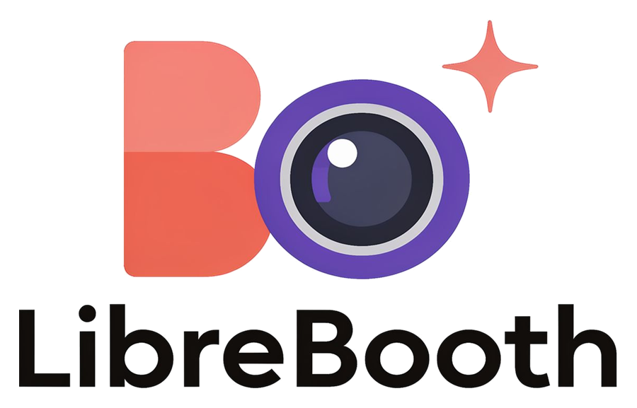
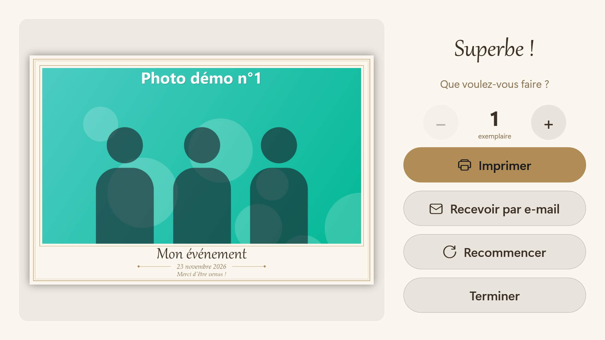
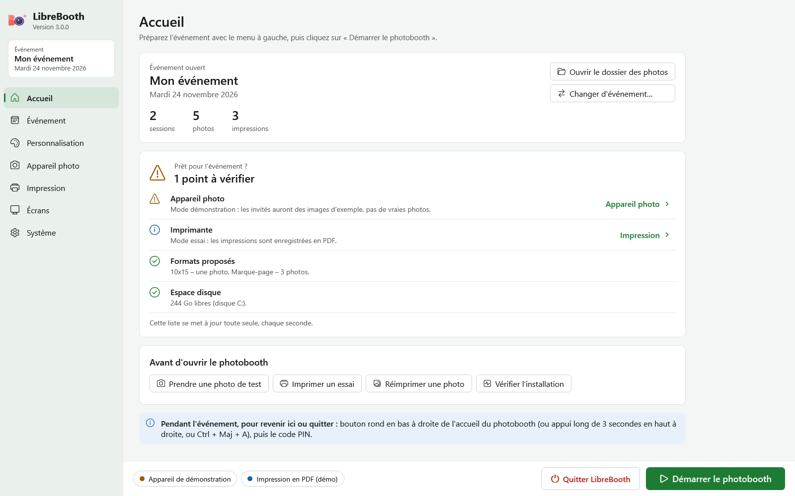
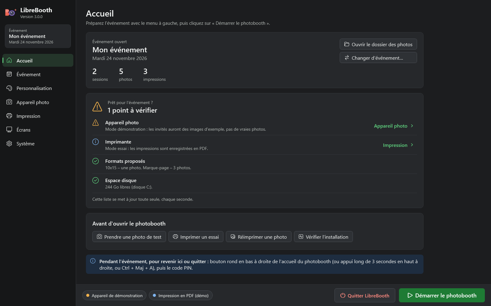
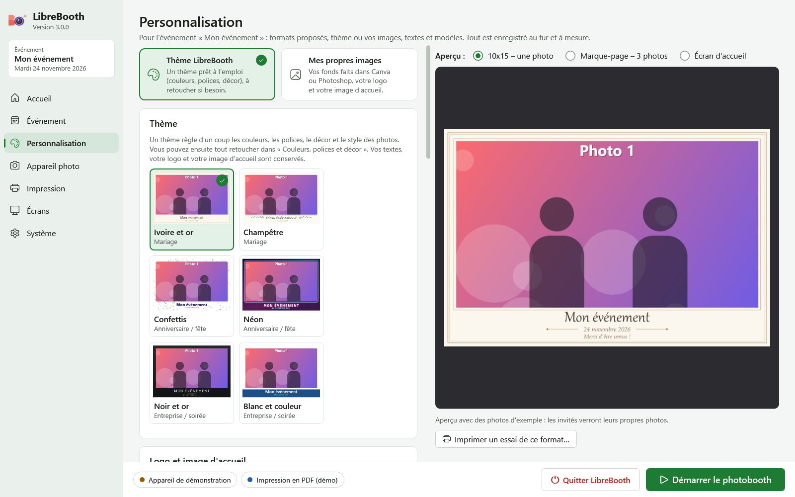
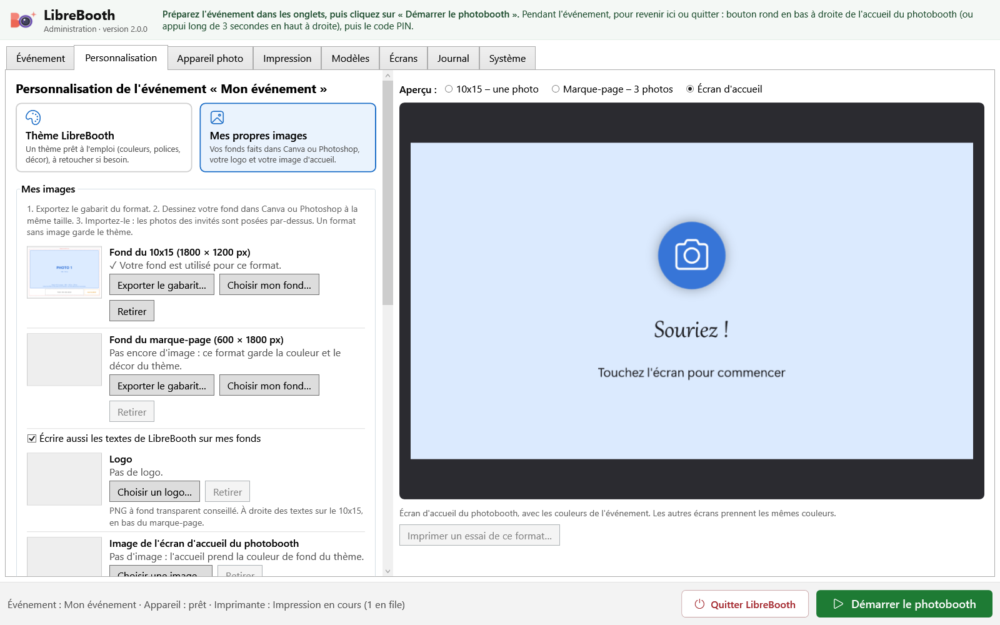
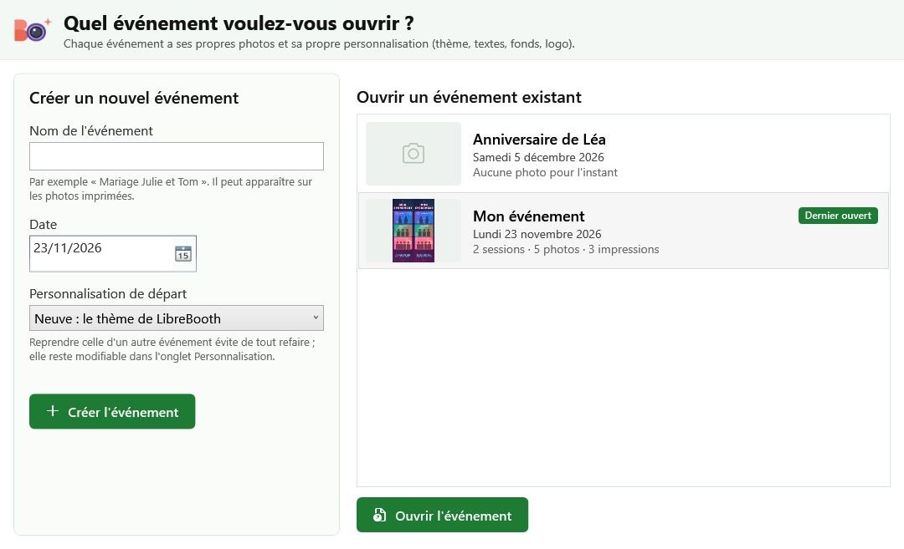

<p align="center">
  <picture>
    <source media="(prefers-color-scheme: dark)" srcset="assets/logo-librebooth-sombre.png">
    
  </picture>
</p>

# LibreBooth

Logiciel de photobooth **gratuit et libre** pour Windows, conçu et réalisé par **Loïs Gonçalves**.

LibreBooth pilote un appareil photo **Canon EOS** et imprime sur une imprimante photo **DNP**, avec un écran tactile
(ou une souris). Il est fait pour les mariages, anniversaires et soirées d'entreprise : chaque événement a ses
propres impressions, ses propres écrans et son propre dossier de photos.

<p align="center">
  
  
</p>

## Ce que fait LibreBooth

- **Un événement à la fois** : au lancement, LibreBooth propose d'ouvrir un événement ou d'en créer un nouveau, avec
  le nom de votre choix. Chaque événement garde sa personnalisation (thème, textes, fonds, logo) et ses photos.
- **Accueil plein écran** : « Touchez l'écran pour commencer », ou un bouton d'arcade USB qui imite une touche.
- **Choix du format** : **10x15 une photo** ou **marque-page 3 photos** (imprimé deux fois sur un 10x15 que la DNP
  coupe en deux).
- **Live view** du Canon en plein écran, en miroir, avec un **compte à rebours** et un flash blanc.
- **Montage automatique** habillé pour l'événement : six thèmes (mariage, anniversaire, entreprise), textes, polices,
  couleurs, décor, ou vos **propres images** (fonds faits dans Canva ou Photoshop, logo).
- **Écrans aux couleurs de l'événement**, avec une image d'accueil propre à chaque événement.
- **Impression** sur la DNP : l'invité choisit ses exemplaires (jusqu'au maximum fixé pour l'événement).
- **Recommencer** : l'invité refait sa série tant qu'il n'a rien imprimé ; la série refusée est gardée à part.
- **Admin d'abord** : au lancement, le code PIN, le choix de l'événement, puis l'administration dans une fenêtre
  normale, en clair ou en sombre. Sa page d'accueil, **« Prêt pour l'événement ? »**, dit d'un coup d'œil ce qui reste
  à vérifier (appareil photo, imprimante, papier, formats, espace disque). Le photobooth plein écran démarre avec
  « Démarrer le photobooth » ; un bouton rond sur son accueil permet, avec le code PIN, de revenir à l'admin ou de
  quitter.
- **Vérification de l'installation** : dossiers, fichiers, pilotes, imprimante et appareil photo, avec ce qu'il faut
  faire en cas de problème.
- **Mises à jour** : quand le PC est connecté à Internet, LibreBooth signale les nouvelles versions et les installe
  depuis l'admin, jamais pendant le photobooth. Sur demande, il propose aussi les pré-versions (versions d'essai),
  avec une mise en garde, et permet de revenir ensuite à la version stable.
- **Fiabilité** : chaque photo est écrite sur le disque dès son arrivée, l'appareil se reconnecte tout seul, une
  erreur affiche un message clair puis le photobooth repart, la mise en veille de Windows est bloquée. L'espace
  disque est surveillé : le photobooth se met en pause avant que le disque soit plein.

<p align="center">
  
  
</p>

<p align="center">
  
  
</p>

## Matériel

| | Conseillé | Testé |
|---|---|---|
| PC | Windows 10 ou 11, **64 bits** | Windows 10 et 11 |
| Appareil photo | Canon EOS en USB, piloté par le pilote intégré à Windows (SDK Canon EDSDK 13 en secours) | Canon EOS 1300D |
| Imprimante | Imprimante photo DNP (sublimation thermique) | DNP DS620, rouleau 15x20 (deux 10x15 par feuille), pilote Windows 11 v2.0.1.2 |
| Écran | Tactile de préférence (la souris marche aussi) | |

## Installation

1. **Téléchargez** la dernière version dans la page [Releases](../../releases) :
   `LibreBooth-x.y.z-Installation.exe` (ou le zip, à décompresser où vous voulez). Le fichier
   `LibreBooth-x.y.z-SHA256.txt` donne leurs empreintes, pour vérifier le téléchargement.
2. **Installez** : double-cliquez sur le programme d'installation. Il n'est pas signé par un éditeur : si Windows
   affiche « Windows a protégé votre ordinateur », cliquez **Informations complémentaires**, puis **Exécuter quand
   même**. LibreBooth s'installe dans `C:\Program Files (x86)\LibreBooth`, avec ses raccourcis. Déjà installé ?
   Le programme d'installation met à jour la version en place (voir aussi [Mettre à jour](#au-quotidien)).
3. **Pilotes** :
   - **Appareil Canon** : rien à installer. LibreBooth pilote le Canon par le pilote intégré à Windows. Seulement si
     Windows ne sait pas piloter votre modèle : admin › Appareil photo › **« SDK Canon (secours) »**. Inscrivez-vous
     (gratuitement) au [programme développeurs de Canon](https://www.canon-europe.com/business/imaging-solutions/sdk/),
     téléchargez le SDK **EDSDK** pour Windows, puis cliquez **« Ajouter le SDK Canon… »** et indiquez le zip reçu :
     LibreBooth en extrait lui-même `EDSDK.dll` et `EdsImage.dll` (version 32 bits).
   - **Imprimante DNP DS620** : son pilote appartient à DNP et ne peut pas être livré avec LibreBooth. Laissez
     cochée la case du pilote : il est téléchargé sur le site officiel de DNP (26 Mo), son empreinte SHA-256 est
     contrôlée, puis il est installé. Branchez ensuite la DS620 en USB et allumez-la. Autre modèle DNP, ou pas
     d'Internet : installez son pilote depuis la [page Téléchargements de DNP](https://dnpphoto.eu/downloads/).
   - **Facultatif** : `cspstat.dll` (API d'état des imprimantes DNP), à copier dans
     `C:\Users\<nom>\LibreBooth\Pilotes`. Elle permet de lire le compteur de tirages et les erreurs (papier, ruban,
     capot). Sans elle, LibreBooth compte lui-même ses tirages.
4. **Vérifiez** : à la fin de l'installation, laissez cochée **« Vérifier que tout fonctionne »**, ou plus tard :
   menu Démarrer › LibreBooth › « Vérifier l'installation de LibreBooth ». Chaque point manquant est expliqué.

Vos photos, événements et réglages sont dans `C:\Users\<nom>\LibreBooth`. Une mise à jour n'y touche jamais, et la
désinstallation les garde, sauf si vous demandez leur suppression (voir [Désinstaller](#désinstaller)). Pas dans
Documents : la protection « Accès contrôlé aux dossiers » de Windows y bloque les logiciels inconnus, et Documents
est souvent synchronisé par OneDrive.

## Premier lancement

1. Lancez **LibreBooth** : le code PIN est demandé (**1234** par défaut : changez-le tout de suite, page
   Système).
2. **Choisissez l'événement** : ouvrez un événement existant, ou créez-en un avec son **nom** (il peut apparaître
   sur les photos), sa **date** et sa personnalisation de départ : le thème de LibreBooth, ou celle d'un autre
   événement pour ne pas tout refaire.
3. L'administration s'ouvre dans une fenêtre normale, sur sa page **Accueil**. Réglez l'événement avec le menu à
   gauche :
   - **Personnalisation** : formats proposés, exemplaires, le mode « Thème LibreBooth » ou « Mes propres images »,
     et en bas les modèles ;
   - **Impression** : vérifiez que l'imprimante DNP est choisie (c'est automatique) ;
   - **Écrans** : textes, compte à rebours, délais, bouton « Recommencer » ;
   - **Système** : code PIN, apparence claire ou sombre, lancement au démarrage de Windows, mises à jour.
4. Revenez à l'**Accueil** : « Prêt pour l'événement ? » liste ce qui reste à vérifier, avec un bouton vers la bonne
   page. Puis cliquez sur **« Démarrer le photobooth »**.
5. Pendant l'événement, pour revenir à l'admin ou quitter : **bouton rond en bas à droite** de l'accueil, puis le code
   PIN. L'appui de 3 secondes dans le coin en haut à droite (ou `Ctrl+Maj+A`) mène aussi à l'admin.

<p align="center"></p>

<p align="center"></p>

## Personnaliser les impressions

Tout se règle **pour chaque événement**, dans l'admin › **Personnalisation**, avec un aperçu en direct.

| Modèle | Impression | Photos |
|---|---|---|
| **10x15 – une photo** | 10x15 paysage (1800 × 1200 px) : une grande photo, textes et logo en bas | 1 |
| **Marque-page – 3 photos** | marque-page 5x15 (600 × 1800 px), imprimé deux fois sur un 10x15 que la DNP coupe au milieu : chaque exemplaire donne **2 marque-pages** | 3 |

En haut de la page, choisissez le **mode** :

- **Thème LibreBooth** : un thème prêt à l'emploi, à retoucher si besoin.

  | Thème | Pour | Style |
  |---|---|---|
  | Ivoire et or | Mariage | fond ivoire, filets dorés, écriture calligraphiée |
  | Champêtre | Mariage | blanc cassé, feuillage vert sauge, écriture manuscrite |
  | Confettis | Anniversaire / fête | fond blanc, confettis de couleur, police ronde et grasse |
  | Néon | Anniversaire / fête | fond nuit, cadres lumineux rose et bleu |
  | Noir et or | Entreprise / soirée | fond noir, ligne dorée, majuscules espacées |
  | Blanc et couleur | Entreprise / soirée | fond blanc, bandeau à la couleur de l'entreprise |

- **Mes propres images** : vos fonds passent en premier (fond du 10x15, fond du marque-page, logo, image d'accueil).
  1. **Exporter le gabarit** du format : une image à la bonne taille qui montre où tombent les photos, les textes et
     le logo, avec la marge de sécurité de 3 mm ;
  2. dessinez votre fond dans Canva, Photoshop ou Photopea à la même taille ;
  3. **Choisir mon fond** : les photos des invités sont posées par-dessus. Un format sans fond garde le thème.

Textes : `{evenement}` est remplacé par le nom de l'événement, `{date}` par 22.11.2026 et `{date_longue}` par
22 novembre 2026. **Imprimer un essai** imprime le format affiché, avec des photos d'exemple.

Les écrans du photobooth (accueil, choix du format, photo, fin) prennent les couleurs et la police du titre des
impressions. Pour un cadre complet fait ailleurs, admin › Personnalisation › **Modèles et cadres PNG** ›
**Importer un cadre PNG…** (zones transparentes à l'emplacement des photos, 1800 × 1200 px pour un 10x15).

## Réglages conseillés

**Appareil Canon** (exemple : EOS 1300D)

| Réglage | Valeur conseillée | Pourquoi |
|---|---|---|
| Mode | **M** (manuel), exposition réglée sur l'éclairage du booth | Exposition stable d'une photo à l'autre |
| Éclairage | Éclairage continu (panneau LED, softbox) | Le live view montre alors exactement la photo |
| Objectif | **MF** (mise au point manuelle), faite une fois sur la place des invités | L'autofocus peut échouer dans la pénombre |
| Qualité | **JPEG M** (pas de RAW) | Transfert plus rapide, largement suffisant pour un 10x15 |
| Extinction automatique | **Désactivée** | Sinon l'appareil se met en veille |
| Wi-Fi | **Désactivé** | Wi-Fi actif = USB inactif |
| Alimentation | Coupleur secteur (DR-E10 + ACK-E10 pour le 1300D) | Une batterie ne tient pas une soirée en live view |
| Logiciels Canon | EOS Utility fermé | Un seul logiciel à la fois peut piloter l'appareil |

**Imprimante DNP** : tout est automatique au premier lancement. LibreBooth choisit la DNP et prépare deux réglages
du pilote : « 10x15 » (sans bord, coupe standard) et « Bandelettes » (sans bord, **coupe 2 pouces**, utilisé par
le marque-page). Le pilote DNP lit la coupe dans un bloc de réglages qui lui est propre : LibreBooth le remplit
lui-même. Si vous réglez un format à la main (« Réglages du pilote… »), validez toujours la fenêtre du pilote par
**OK**. Sur un rouleau 15x20, chaque 10x15 utilise une demi-feuille.

## Au quotidien

- **Changer d'événement** : au lancement de LibreBooth, ou admin › Événement › « Changer d'événement… ». La même
  page renomme l'événement (son dossier suit) et ouvre son dossier de photos.
- **Dossier de l'événement** : `C:\Users\<nom>\LibreBooth\Evenements\2026-11-23 Mariage Julie et Tom\`, avec
  `Photos` (photos de l'appareil), `Montages` (photos imprimées) et `Photos refusées` (séries recommencées). Ce dont
  LibreBooth a besoin pour l'événement (personnalisation, fiches des sessions) est rangé à part, dans le dossier
  caché `.librebooth`. Les événements des versions 1.x sont convertis au premier lancement de la 2.0.0, sans perdre
  une photo.
- **Réimprimer** une photo : admin › Événement › Galerie.
- **Espace disque** : gardez au moins **2 Go** libres sur le disque des photos (environ 170 sessions). En dessous,
  « Démarrer le photobooth » prévient, et l'on peut démarrer quand même. Sous **300 Mo**, le photobooth ne lance plus
  de session : son accueil affiche « Le photobooth fait une pause » et prévient l'animateur. Videz la corbeille de
  Windows, ou déplacez d'anciens événements (dossier `Evenements`) sur une clé USB ou un disque externe : les sessions
  reprennent toutes seules en quelques secondes.
- **Mode sombre** : admin › Système › Apparence.
- **Mettre à jour** : quand une nouvelle version est publiée, un bandeau l'annonce dans l'admin. Admin › Système ›
  Mises à jour › **« Installer la mise à jour »** : LibreBooth la télécharge depuis GitHub, contrôle son empreinte
  SHA-256, puis se ferme. Windows demande l'autorisation, la nouvelle version s'installe, et « Terminer » relance
  LibreBooth. Photos, événements, réglages et pilotes sont gardés. Une copie décompressée depuis le zip (sans le
  programme d'installation) ne se met pas à jour seule : l'admin donne le lien de la nouvelle version.
- **Essayer une pré-version** : admin › Système › Mises à jour › **« Proposer aussi les pré-versions »** (coupé au
  départ). L'admin propose alors aussi les versions d'essai publiées sur GitHub, en orange, avec une mise en garde
  avant de les installer : à réserver aux essais, jamais juste avant un événement. Tant qu'une pré-version est
  installée, l'accueil le rappelle (« Pré-version installée »), et Système › Mises à jour propose **« Revenir à la
  version stable »**.
- **Quitter** : bouton « Quitter LibreBooth » en bas de l'admin, ou bouton rond de l'accueil du photobooth (code PIN).
- **Journal** : admin › Système › Journal (dépannage), ou `C:\Users\<nom>\LibreBooth\logs`.
- **Diagnostic complet du matériel** (live view, photo de test), LibreBooth fermé :

  ```powershell
  & "C:\Program Files (x86)\LibreBooth\LibreBooth.exe" --diagnostic
  ```

## Désinstaller

Paramètres de Windows › Applications › Applications installées › LibreBooth › Désinstaller, ou menu Démarrer ›
LibreBooth › « Désinstaller LibreBooth ». Le programme, ses raccourcis et son inscription dans Windows sont retirés.
Deux cases, au choix :

- **« Supprimer aussi les réglages et les fichiers de LibreBooth »** : réglages, modèles, personnalisations des
  événements, pilotes ajoutés (SDK Canon) et journaux ;
- **« Supprimer aussi les photos de tous les événements »** (après confirmation) : tout le dossier `Evenements`.

Sans case cochée, photos et réglages restent dans `C:\Users\<nom>\LibreBooth`, prêts pour une prochaine
installation. Ce qui est supprimé part dans la **Corbeille** de Windows : on peut encore le récupérer. Le pilote de
l'imprimante DNP reste installé.

## Dépannage

| Problème | Solutions |
|---|---|
| « Aucun appareil Canon détecté » | Appareil allumé, branché directement sur le PC (sans hub), Wi-Fi de l'appareil coupé, EOS Utility fermé. |
| « Windows ne sait pas le piloter » | Admin › Appareil photo › « SDK Canon (secours) », puis « Ajouter le SDK Canon… » avec le zip téléchargé chez Canon. |
| « Pilote Canon introuvable » (SDK Canon choisi) | Admin › Appareil photo : revenez au « Pilote de Windows », ou ajoutez le SDK téléchargé chez Canon. |
| Photos trop sombres | Passez l'appareil en M et réglez vitesse, ouverture et ISO sur la lumière du booth. |
| La photo n'est pas prise | Objectif en MF, qualité en JPEG (pas RAW seul). |
| Aucune imprimante DNP | Relancez le programme d'installation avec la case du pilote cochée (ou installez-le depuis le site de DNP), puis branchez la DNP en USB et allumez-la. |
| Marque-pages non coupés | Admin › Impression › « Réglages automatiques DNP », puis une page de test. |
| « GitHub n'a pas pu être joint » (mises à jour) | Pas d'Internet, ou réseau qui bloque GitHub. LibreBooth fonctionne sans ; une fois connecté : admin › Système › « Rechercher maintenant ». |
| « Disque presque plein : sessions en pause » | Videz la corbeille de Windows, ou déplacez d'anciens événements (dossier `Evenements`) sur une clé USB : le photobooth reprend tout seul. |
| Autre chose | Menu Démarrer › LibreBooth › « Vérifier l'installation de LibreBooth », puis le journal (admin › Système › Journal). |

## Données et vie privée

LibreBooth fonctionne sans compte ni connexion : les photos restent sur le PC, dans le dossier de chaque
événement, et rien n'est envoyé sur Internet. LibreBooth se connecte seulement à GitHub pour savoir si une nouvelle
version existe (il ne transmet que son numéro de version ; case à décocher dans admin › Système › Mises à jour), et
le programme d'installation télécharge le pilote de la DS620 sur le site de DNP.

## Compiler depuis les sources

Il faut le [SDK .NET 10](https://dotnet.microsoft.com/download) (LibreBooth est en C#, WPF, 32 bits).

```powershell
dotnet build LibreBooth.sln
```

```powershell
dotnet test
```

```powershell
dotnet run --project src\LibreBooth.App -- --demo --fenetre
```

- `--demo` : appareil photo de démonstration et impression en PDF, pour tout essayer sans matériel.
- Un vrai Canon se pilote depuis les sources sans rien ajouter (pilote de Windows). Pour le SDK Canon (secours) ou
  l'état de la DNP, posez les fichiers des fabricants dans `drivers\` (voir `drivers\README.md`) ou dans le dossier
  `Pilotes`.
- `.\installer\fabriquer-installation.ps1 -Public` fabrique le programme d'installation, le zip et leurs empreintes
  dans `publish\github`, **sans aucun fichier de Canon ou de DNP**.
- `--captures <dossier>` : parcours automatique en mode démo qui enregistre chaque écran en image.
- `--source-mises-a-jour <adresse>` : autre adresse que GitHub pour essayer les mises à jour (même format que l'API
  « releases » de GitHub ; `http` seulement sur le PC lui-même).

**Sans l'appareil ni l'imprimante**, on peut modifier et vérifier presque tout : `dotnet test`, `--demo` et
`--captures`. Ce qui touche au Canon, à l'état de la DNP ou à la coupe se valide ensuite sur le booth.

### Numéros de version

Un seul numéro pour tout LibreBooth, dans `Directory.Build.props` : **majeure.fonction.correctif** (par exemple
2.1.3). C'est lui que les mises à jour comparent à la dernière version publiée.

| Type | Exemple | Quand |
|---|---|---|
| `correctif` | 2.1.0 → 2.1.1 | correction d'un problème, sans nouveauté |
| `fonction` | 2.1.1 → 2.2.0 | nouvelle fonction ou changement visible, sans rien casser |
| `majeure` | 2.2.0 → 3.0.0 | changement qui modifie les habitudes ou les fichiers de l'utilisateur |

```powershell
.\installer\nouvelle-version.ps1 -Type correctif -Note "Correction de …"
```

Le script change le numéro et ajoute une entrée en haut de [`CHANGELOG.md`](CHANGELOG.md), à compléter.
`fabriquer-installation.ps1` refuse ensuite d'écraser une version déjà fabriquée. Pour que LibreBooth trouve une
nouvelle version, sa page Releases porte l'étiquette `vX.Y.Z` et les fichiers `LibreBooth-X.Y.Z-Installation.exe` et
`LibreBooth-X.Y.Z-SHA256.txt` ; une version marquée « pre-release » est ignorée.

## Licence et crédits

LibreBooth est publié sous **licence MIT** : © 2026 Loïs Gonçalves (voir [`LICENSE`](LICENSE)). Les composants
libres utilisés sont listés dans [`THIRD-PARTY-NOTICES.md`](THIRD-PARTY-NOTICES.md).

Le SDK Canon EDSDK, l'API d'état DNP et le pilote de la DS620 appartiennent à leurs fabricants et ne sont pas
distribués avec LibreBooth : le programme d'installation télécharge le pilote de la DS620 sur le site de DNP, et
c'est vous qui téléchargez le SDK chez Canon si vous le choisissez en secours. Sans lui, LibreBooth pilote le Canon
par le pilote intégré à Windows, avec les commandes des Canon EOS décrites par le projet libre
[gPhoto2](http://www.gphoto.org/) (aucun code de gPhoto2 n'est repris). Canon, EOS et DNP sont des marques de leurs
propriétaires ; LibreBooth n'est ni affilié à ces sociétés, ni approuvé par elles.

Historique des versions : [`CHANGELOG.md`](CHANGELOG.md).
